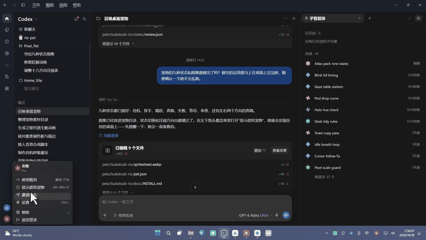
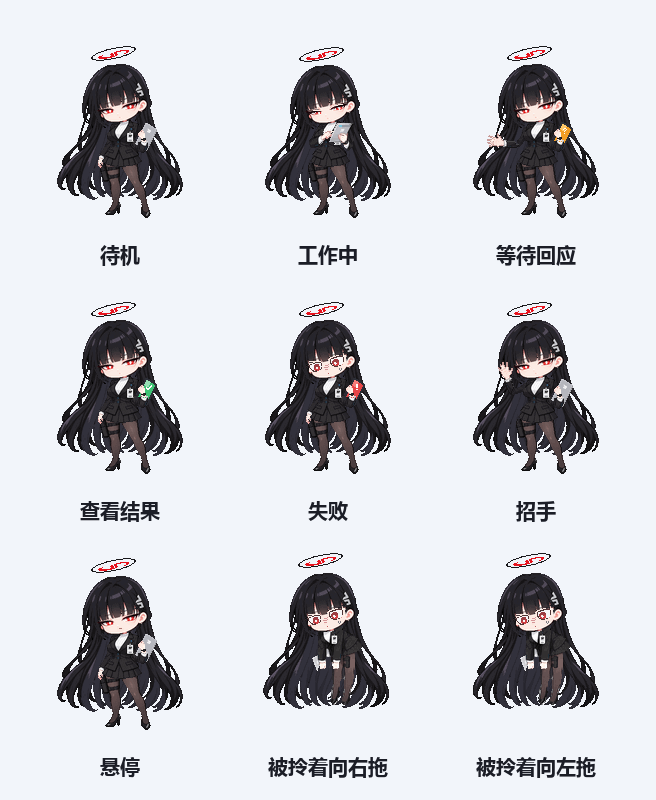
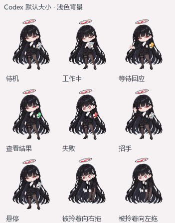
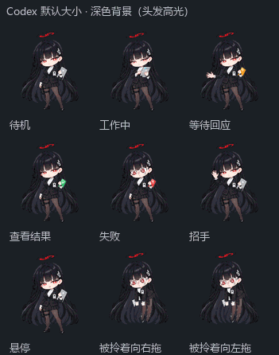
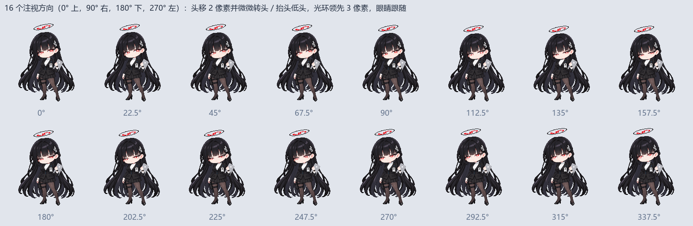

<p align="center">
  
</p>

<h1 align="center">调月莉音 · Codex 桌面宠物</h1>

<p align="center">
  《蔚蓝档案》同人 · 像素桌面宠物 · 跟着 Codex 的任务状态切换动作<br>
  <b>宣传片：</b>见下方预览；B 站完整版待发布。
</p>

---

她叫调月莉音，千年科学学园研讨会会长，理性主义者，生活能力为零。

这个仓库是她的 **Codex 桌面宠物**：装进 Codex 之后，她会待在你的桌面上，并按 Codex 的任务状态及悬停、拖动等交互切换动作。另附一个**网页版**，可以把她拎起来拖动，她的视线会跟着你的鼠标。

<p align="center">
  
</p>

## 预览

**九种状态**（包含任务状态、招手、悬停与拖动）

<p align="center"></p>

**Codex 显示大小模拟**

下图由最终图集按约 113 像素宽缩放生成，用于对比浅色和深色背景；不是 Codex 实机录屏。

<p align="center">
  
  
</p>

**16 个注视方向预览**

<p align="center"></p>

## 安装

1. 下载 [Releases](https://github.com/XQZ003/tsukatsuki-rio-codex-pet/releases) 里的 `tsukatsuki-rio-codex-pet-v1.0.0.zip` 并解压，或者直接使用本仓库的 [`pet/red-eye-secretary/`](pet/red-eye-secretary) 文件夹。
2. 把整个 `red-eye-secretary` 文件夹放进 Codex 的宠物目录：

   | 系统 | 宠物目录 |
   |---|---|
   | Windows | `%USERPROFILE%\.codex\pets\` |
   | macOS / Linux | `~/.codex/pets/` |

   如果你设置过环境变量 `CODEX_HOME`，目录就是 `%CODEX_HOME%\pets\`（macOS / Linux 为 `$CODEX_HOME/pets/`）。放好后应该是 `…\pets\red-eye-secretary\pet.json`。
3. **完全退出 Codex 再重新打开**，在宠物设置里选择「调月莉音」。
4. 在左下角头像菜单里打开「显示虚拟宠物」，Windows 已核对版本的快捷键是 `Alt + Win + P`；其他平台及版本请以实际菜单为准。

**可选：让像素一比一。** 已核对版本的默认预览宽约 113 像素，还会做平滑缩放，所以细小的动作会被抹平。在 Codex 的宠物设置里把大小调到 **192**，像素就是一比一的。

如果你的版本里找不到这个选项，也可以在 `config.toml`（默认 `~/.codex/config.toml`）的 `[desktop]` 段里设置宽度。修改前先备份；这项设置不一定在所有版本里都生效。

```toml
[desktop]
avatar-overlay-mascot-width-px = 192
```

## 网页版

用浏览器直接打开 [`web/rio-web.html`](web/rio-web.html)。它是单个文件，不联网，不需要安装。
- 鼠标移到她身上，她会看向你；
- 按住可以把她拎起来拖动（手机上用手指），松手后她会落回地面，长发会跟着摆动再停稳；
- **实时母版**模式按连续时间播放，姿势之间有中间帧，眨眼和视线是实时的；**Codex 帧模式**只播放图集里的那几帧，按已核对版本的帧时序模拟播放；实际客户端行为以所用版本为准；
- 可以切换浅色和深色背景、播放速度，以及 Codex 默认大小和一比一大小。

## 状态对照

| Codex 中的状态 | 她的动作 | 帧数 | 每帧时长 (ms) |
|---|---|---|---|
| 待机 `idle` | 拿着平板待命 | 6 | 1680 / 660 / 660 / 840 / 840 / 1920 |
| 工作中 `running` | 看着平板工作 | 6 | 120 ×5，220 |
| 等待回应 `waiting` | 拿出提示，等你回应 | 6 | 150 ×5，260 |
| 查看结果 `review` | 拿出完成的标记 | 6 | 150 ×5，280 |
| 失败 `failed` | 出现没算到的变量 | 8 | 140 ×7，240 |
| 招手 `waving` | 第一次打招呼 | 4 | 140 / 140 / 140 / 280 |
| 悬停 `jumping` | 鼠标移到她身上 | 5 | 140 ×4，280 |
| 被拎着向右 / 向左拖 `running-right` / `running-left` | 被拖动时的样子 | 8 / 8 | 120 ×7，220 |

图集规格：每格 192 × 208 像素，8 列 × 11 行；最后两行是 16 个注视方向。

已核对版本的播放规则（网页版 Codex 帧模式按此模拟）：
- 状态一变，就从第 1 帧重新播放；
- 非待机动作播放 3 轮后回到待机；
- 鼠标悬停时切到“悬停”；
- 拖动时横向移动 4 像素以上，切到“被拎着拖”。

## 文件说明

```
pet/red-eye-secretary/
  pet.json            宠物描述（id: red-eye-secretary）
  spritesheet.webp    图集（Codex 读取这个）
  spritesheet.png     同一图集的 PNG 版本
web/rio-web.html      网页版（单文件）
docs/images/          说明用的图片
NOTICE.md             声明与使用条款
```

## 关于这部同人作品

- 角色设定和梗来自游戏与社区资料：卫星村、Big Sister、“我一直都在看着”、生活能力为零、咖啡因胶囊，等等。
- 像素形象由 AI 辅助生成素材后整理，动画、网页版与宣传片以代码制作；未使用游戏原有的语音或音乐。
- 宣传片用代码逐帧生成，配乐和音效也是原创。

制作过程中使用 AI 辅助生成与整理形象素材、编写代码和制作程序化音频；使用的工具包括 Claude、Codex、Gemini。

## 兼容性与验证范围

这是 Codex 桌面客户端的 v2 宠物包。安装目录覆盖 Windows、macOS、Linux 的常用路径写法，不代表三个平台均已实测。已在 Windows 客户端中显示过角色；本次发布准备检查了包结构、文档、压缩包和素材一致性，未逐项重测客户端的九种状态与注视触发。

## 声明

本作品是《蔚蓝档案》的非官方同人作品，与 NEXON Games、Yostar 以及 OpenAI 均无关。角色“调月莉音”的版权归原作所有。使用条款见 [NOTICE.md](NOTICE.md)。

作者：XQZ003
